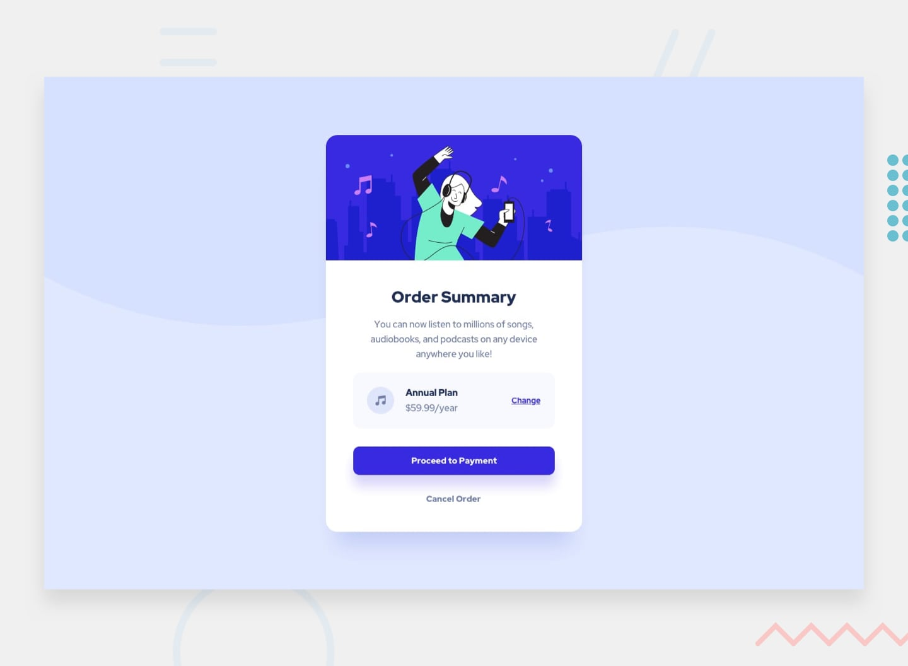

# 📌 Order Summary Component
 
This project is a solution to the "Order Summary Component" challenge on Frontend Mentor.

The challenge focuses on building an order summary card component using only HTML and CSS. The goal was to reproduce the provided design as closely as possible, practice building a clean card layout, and add hover states for the interactive elements.


## 🖼️ Preview




## 🎯 Overview

During the development of this project, the following aspects were implemented:

- Building the order summary card using semantic HTML elements
- Adding the hero illustration and the background pattern image
- Displaying the plan details with an icon, plan name, price, and a "Change" link
- Creating the "Proceed to Payment" and "Cancel Order" actions
- Implementing hover states for all interactive elements
- Adapting the layout to the provided mobile and desktop designs
- Applying the provided colors, typography, spacing, and visual hierarchy
- Reproducing the provided design as closely as possible


## 🧠 What I Learned

Through this project, I practiced:

- Writing meaningful alt text for informative images and leaving it empty for decorative ones
- Defining reusable colors and font sizes with CSS custom properties (--variable)
- Adding a background pattern with background-image, background-repeat, background-position, and background-size


# 🛠️ Tech Stack & Concepts
 
- **Markup:** Semantic HTML
- **Styling:** CSS
- **Responsive Design:** Mobile & desktop layouts
- **Layout:** CSS Box Model & Flexbox
- **Interactive States:** Hover states
- **Code Formatting:** Prettier
- **Version Control:** Git & GitHub


## 🔗 Links

- 💻 **Live Demo:** https://ncticn.github.io/014-order-summary-component
- 🧠 **Challenge:** [CHALLENGE_URL]


## ⚙️ Installation & Running the Project

To run this project locally, follow these steps:

```bash
# Clone the repository
git clone https://github.com/Ncticn/javascript-projects.git

# Navigate to the project directory
cd 014-order-summary-component
```

Then open the project with a local development server, such as the **Live Server** extension in VS Code.


## 👤 Author

**Ncticn**  
Front-End Developer

- GitHub: https://github.com/Ncticn
- LinkedIn: https://www.linkedin.com/in/ncticn/
- Frontend Mentor: https://www.frontendmentor.io/profile/Ncticn


## 📝 License

This project is licensed under the MIT License.  
© 2026 Ncticn.